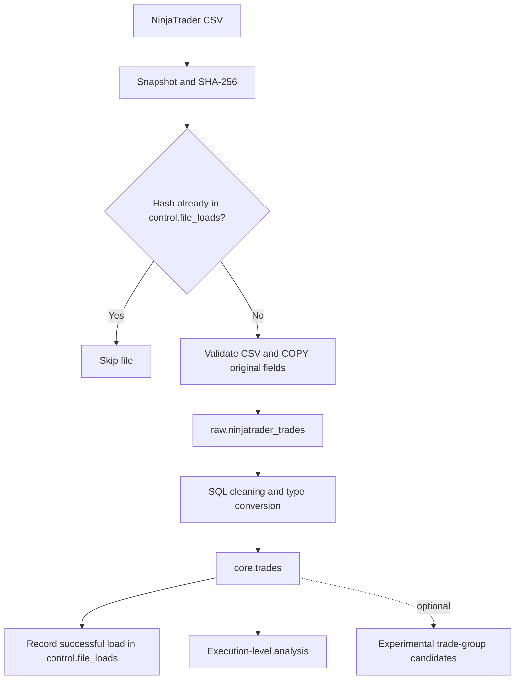

# NinjaTrader Trading ETL Pipeline

A Python and PostgreSQL pipeline that imports NinjaTrader trade-history CSV exports, preserves source values and lineage, converts them into typed execution records, and prevents repeat ingestion of identical files using SHA-256.

**Project status:** the ingestion workflow was reported working in the project conversation. This repository reconstructs that workflow from the available code and timestamp patch. The original database DDL was unavailable, so the supplied tables are a documented fresh-database bootstrap. **Logical trade grouping remains experimental and unfinished.** See [implementation notes](docs/implementation_notes.md), [grouping status](docs/trade_grouping.md), and [validation results](docs/validation.md).

## Pipeline



Raw rows, typed core rows, and the success record commit in one transaction. Failure rolls all three back. The loader uses a transaction-scoped advisory lock to serialize simultaneous attempts for the same file hash. More detail: [architecture](docs/architecture.md).

## Included capabilities

- UTF-8 CSV parsing with or without a BOM, and the known single trailing blank column.
- Strict validation of the recovered 19-column export layout.
- SHA-256 identity based on file bytes, independent of the filename.
- Psycopg 3 `COPY` into `raw.ninjatrader_trades`; source fields remain text.
- SQL conversion into `core.trades`, including dollar/comma removal, accounting negatives for Profit and Cum. net profit, integer casts, and both AM/PM and `HH24` timestamp formats.
- `source_file`, `source_file_hash`, `source_row_number`, and `loaded_at` lineage.
- Success counts in `control.file_loads`; parameterized database calls.
- Synthetic sample data, unit and optional PostgreSQL integration tests, and a GitHub Actions test workflow.

File-level duplicate prevention does **not** deduplicate overlapping exports. A changed byte, BOM, or line ending creates a different hash. Use non-overlapping exports for combined analytics.

## Repository layout

```text
trading-etl/
├── README.md
├── requirements.txt
├── .gitignore
├── .env.example
├── .github/workflows/tests.yml
├── src/
│   ├── __init__.py
│   └── load_trades.py
├── sql/
│   ├── create_schemas.sql
│   ├── create_tables.sql
│   ├── core_transformations.sql
│   ├── trade_grouping.sql
│   └── analysis_queries.sql
├── docs/
│   ├── architecture.md
│   ├── implementation_notes.md
│   ├── trade_grouping.md
│   └── validation.md
├── sample_data/
│   ├── README.md
│   └── sample_trades.csv
└── tests/
    ├── test_transformations.py
    └── test_integration.py
```

## Quick start (PowerShell)

Prerequisites: Python 3.12, PostgreSQL with its `psql` and `createdb` clients on `PATH`, and a database role authorized to create a development database. PostgreSQL 18 is the locally tested version. Work from this repository's root.

```powershell
py -3.12 -m venv .venv
.\.venv\Scripts\python.exe -m pip install -r requirements.txt

$env:PGHOST = 'localhost'
$env:PGPORT = '5432'
$env:PGUSER = 'postgres'  # Or your development role
$env:PGDATABASE = 'trading_etl_demo'
```

Authenticate using your existing PostgreSQL password file or set `PGPASSWORD` in your local session. The example file lists supported settings; the loader does **not** automatically read `.env` files. No credentials are supplied or needed in the repository.

Create a **new empty development database**. These scripts bootstrap a compatible schema; they are not migrations for your existing trading database.

```powershell
createdb trading_etl_demo
psql -v ON_ERROR_STOP=1 -f sql/create_schemas.sql
psql -v ON_ERROR_STOP=1 -f sql/create_tables.sql
psql -v ON_ERROR_STOP=1 -f sql/core_transformations.sql

.\.venv\Scripts\python.exe src/load_trades.py sample_data/sample_trades.csv
```

Run the same loader command again to verify it reports an already-loaded file. Check counts and execution-level summaries with:

```powershell
psql -v ON_ERROR_STOP=1 -f sql/analysis_queries.sql
```

On macOS/Linux, use `python3 -m venv .venv`, `.venv/bin/python`, and shell `export PG...` assignments; the Python entry point and SQL files are identical.

For a layout-only check without PostgreSQL or Psycopg:

```powershell
py -3.12 src/load_trades.py sample_data/sample_trades.csv --validate-only
```

This checks encoding, header, CSV syntax, and row widths. It does not validate database numeric or timestamp conversions. Conversion errors during an actual load roll back the entire file; correct the export and retry. The CLI returns exit code 1 on failure.

## Source contract

The recovered header is case-sensitive and ordered:

```text
Trade number,Instrument,Account,Strategy,Market pos.,Qty,Entry price,Exit price,Entry time,Exit time,Entry name,Exit name,Profit,Cum. net profit,Commission,MAE,MFE,ETD,Bars
```

One extra empty field at the end of the header and each row is accepted. Reordered, renamed, missing, or populated extra columns are rejected. Source row numbers count CSV records including the header as record 1; the first data record is 2. A quoted multiline record counts once. Empty records are skipped without renumbering later records.

Examples of SQL conversion:

| Source value | Core value |
| --- | --- |
| `$1,250.00` | `1250.00` |
| `($125.50)` in Profit | `-125.50` |
| `(125.50)` in Cum. net profit | `-125.50` |
| `11/06/2025 14:35:00` | `2025-11-06 14:35:00` |
| `9/3/2024 3:26:17 AM` | `2024-09-03 03:26:17` |
| Blank numeric or timestamp | SQL `NULL` |

Prices and monetary fields retain the recovered `NUMERIC(18,2)` choice. Greater precision will be rounded, so review this before using instruments requiring more than two decimal places. Timestamps retain source wall-clock values without a timezone; no exchange timezone or trading-session classification is inferred.

## Trade grouping is still in development

The intended model connects original A–E entries and later Scale C/D/E entries into one logical trade. The stated rule is that the current batch must fully close before the next original batch starts in the same direction.

The latest discussion still reported a new A batch being merged into the previous group: about 10/11 records appeared where that particular group should have had seven. The supplied optional SQL preserves the visible time-overlap approach and labels its missing continuation as reconstructed. It does not claim to fix this case.

```powershell
# Optional review view only; not required by ingestion or analysis_queries.sql
psql -v ON_ERROR_STOP=1 -f sql/trade_grouping.sql
```

Read [trade_grouping.md](docs/trade_grouping.md) before using `analytics.trade_group_candidates`. Candidate numbers are local to file/account/instrument/strategy/direction. Do not report logical trade counts or trade win rates from this draft.

## Tests

```powershell
.\.venv\Scripts\python.exe -m unittest discover -s tests -v
```

Pure tests run without PostgreSQL. Database tests are skipped unless `TEST_DATABASE_DSN` is set. Use only a disposable test database; see [validation.md](docs/validation.md) for setup and coverage. GitHub Actions provisions a fresh PostgreSQL service and runs the same suite on push and pull request.

## Using your own exports

Keep real exports in the ignored `data/` directory and run `src/load_trades.py` with a quoted path. The included sample is entirely synthetic and contains no real account identifiers, trading results, or proprietary strategy names. Console errors can include source context; inspect logs before sharing them.

Profit reports use the value **as exported**. Whether NinjaTrader included commissions in that value was not confirmed, so analysis displays commission separately. It does not subtract fees again or sum the cumulative-profit field.

## Publish to GitHub

Extract the ZIP, open a terminal in `trading-etl`, and create an empty GitHub repository. Replace the example remote below with your repository's actual URL.

```sh
git init
git add .
git status
git commit -m "Add NinjaTrader PostgreSQL ETL pipeline"
git branch -M main
git remote add origin https://github.com/YOUR-USERNAME/trading-etl.git
git push -u origin main
```

The package excludes credentials, real exports, database files, and conversation transcripts. No license has been selected; add your preferred license if you want to grant reuse rights.

## Next steps

Validate grouping against a manually labeled example of the reported failure; confirm instrument price precision, timezone, and commission treatment; then consider execution-level deduplication across overlapping exports and rejected-record auditing. dbt, Snowflake, orchestration, dashboards, and dimensional models remain future work.

## Author

**Jude King**
