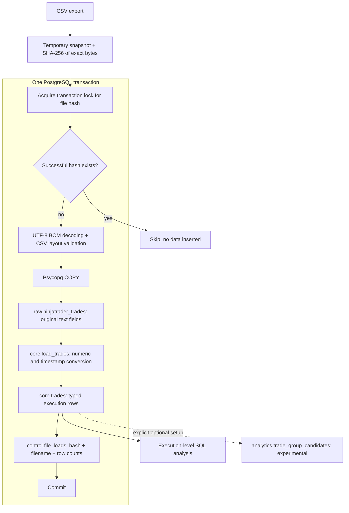

# Architecture

The implementation keeps ingestion, typed transformations, and evolving business logic separate. `raw` and `control` retain the project's original schemas and table concepts; `core.trades` is the typed table recovered from the working loader.

## Lifecycle and failure handling

1. Copy the source into a temporary snapshot while hashing the same bytes in 8,192-byte chunks. The snapshot stabilizes the content used by CSV parsing; the caller should leave the source unchanged while it is copied.
2. Open a PostgreSQL transaction and acquire an advisory lock derived from the first 64 hash bits. All duplicate decisions still compare the full 256-bit hash; a lock-key collision only causes an unnecessary wait.
3. Check `control.file_loads`. A previously committed hash returns a skipped result even if the filename changed.
4. Decode with `utf-8-sig`, validate the recovered header and record widths, and stream field values through Psycopg `write_row`. Quoting and COPY escaping are handled by the libraries.
5. Execute `core.load_trades(file_hash)`. Only this file's raw rows are transformed. A unique constraint on hash and source record ordinal provides row identity.
6. Insert success metadata into `control.file_loads`. Leaving the connection context commits; exceptions roll back raw rows, core rows, and the success record. The temporary snapshot is then removed.

The control table is a successful-load ledger, not an attempt/error log. A failed file is eligible for retry. A header-only export records a zero-row successful load. Core row identity does not infer whether two rows in different exports describe the same execution.

## Data ownership

| Layer | Purpose | Representation |
| --- | --- | --- |
| `raw.ninjatrader_trades` | Source lineage and repeatable transformations | 19 text fields plus file/record/load metadata |
| `control.file_loads` | Successful-file identity and counts | SHA-256 primary key, source basename, counts, load timestamp |
| `core.trades` | Typed execution-level analytics | Integers, two-decimal numerics, source-local timestamps, lineage |
| `analytics.trade_group_candidates` | Optional grouping investigation | Derived candidates and review flags; unfinished |

Raw data preserves decoded CSV values, not a byte-for-byte source archive. Source row numbers are CSV record ordinals. `loaded_at` is a timezone-aware ingestion timestamp; entry and exit values have no timezone because the export's timezone was not established.

## Scope limits

The loader processes one file per invocation. It does not install database objects, alter an existing deployment, group trades, deduplicate overlapping exports, classify sessions, calculate broker-adjusted profit, or publish data. Its transaction guarantee assumes transactional PostgreSQL objects and the normal default read-committed connection setting.

The optional grouping branch is intentionally outside ingestion and normal analysis. Completing it requires verified row membership and boundary rules for original entries and scale-ins.

## Technical references

- [Psycopg transactions](https://www.psycopg.org/psycopg3/docs/basic/transactions.html): connection contexts commit on success and roll back on exceptions.
- [Psycopg COPY](https://www.psycopg.org/psycopg3/docs/basic/copy.html): row-wise COPY adaptation.
- [PostgreSQL date/time formatting](https://www.postgresql.org/docs/18/functions-formatting.html): `HH12` and `HH24` format patterns.
