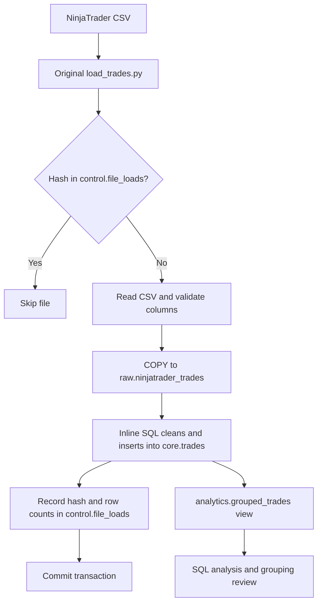

# Architecture

The original Python file coordinates the complete load. It hashes the source, checks the control table, reads the CSV with `utf-8-sig`, validates the header and row widths, and streams source values into PostgreSQL using Psycopg COPY.

The SQL inside that same Python file converts raw text to typed records in `core.trades`. The raw and core tables retain source-file metadata. The control record stores the successful filename, SHA-256 hash, and raw/core row counts. These three writes share a single transaction.

The analytics view is created separately using `sql/trade_grouping.sql`. It calculates groups from the typed timestamps in `core.trades`. Grouping is still being validated against the project's business rules; it is not part of the loader's success criteria.

`sql/core_transformations.sql` is only a readable reference copy of the original inline INSERT. The Python loader remains the executable source of that transformation.
